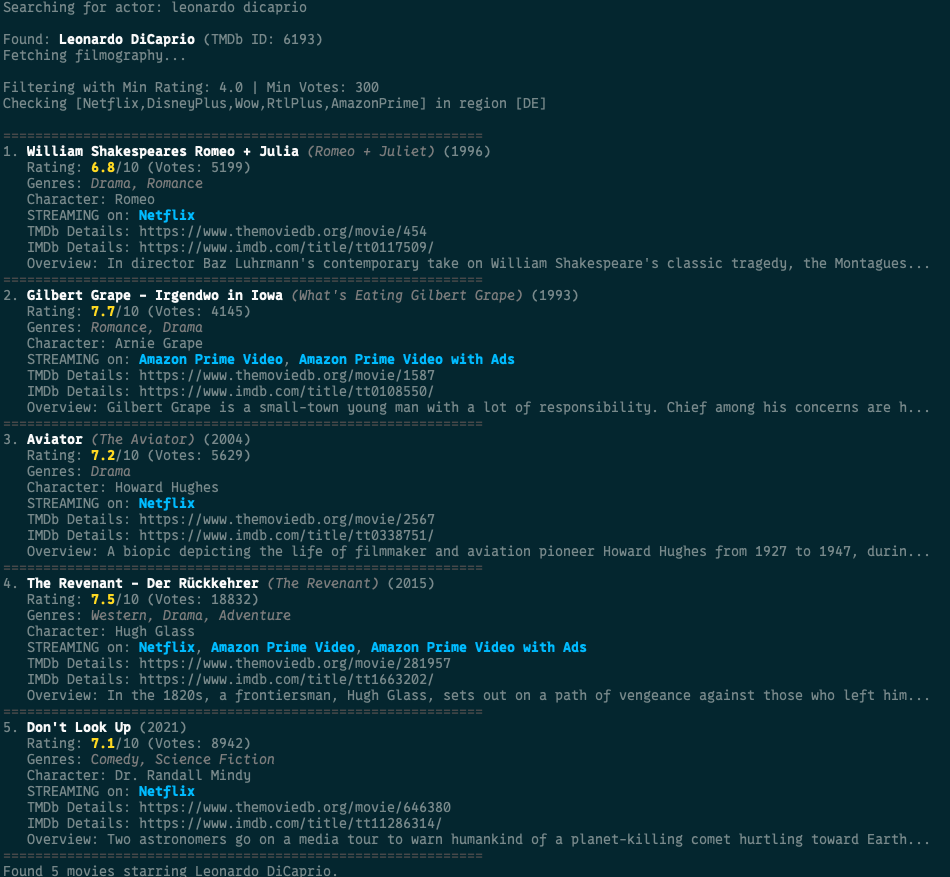

# tmdb - The movie db CLI tool

[](https://github.com/sebastianneubert/tmdb/actions/workflows/tests.yml)

CLI tool to discover hidden gems in your streaming libraries. Fetches data from TMDB and your streaming services to 
help you find movies and shows you might have missed. 

## Example

```bash
tmdb actor "Leonardo DiCaprio"
```


## Build and Install

```bash
go build -o tmdb cmd/main.go # or make build

./tmdb
```

## Setup

1. Get an API key from TMDB: https://www.themoviedb.org/settings/api
2. Copy `.env.example` to `.env`
3. Add your TMDB API key and adjust your preferences:

    ```dotenv
    # .env file
    # use the tmdb providers command to get a list of available providers for your region
    PROVIDERS="Netflix,Disney Plus,Wow,Rtl+,AmazonPrime"
    REGION=DE
    MIN_RATING=7.5
    MIN_VOTES=1000
    API_TIMEOUT_SECONDS=20
    # hide movies with an age rating above this age, 0 = off
    # MAX_AGE=12
    # DEBUG=true
    ```

## Usage

```bash
# Show top rated movies filtered by your .env settings or cli options
./tmdb top --min-rating 6.0

# Show top rated movies filtered by release year
./tmdb top --year 2020 --genre comedy

# list available genres in your language/region
./tmdb genres

# list available streaming providers in your language/region
./tmdb providers

# show popular movies
./tmdb popular --genre action

# Show filmographies of a specific actor
./tmdb actor "Nicolas Cage"

# List popular actors
./tmdb actor

# Search for actors with partial name match and show all options
./tmdb actor "tom"

# Select specific actor from multiple results by index
./tmdb actor "Megan Fox" 1

# Search for movies with "star" in the title like Star Wars, Star Trek, etc.
./tmdb search star

# Show top rated shows
./tmdb shows --min-rating 8.0
```

## Age Rating Filter

`top`, `popular`, `search` and `actor` can hide movies with a too high age recommendation:

```bash
# only movies rated FSK 12 or lower (ratings of your --region, default DE)
./tmdb top --max-age 12

# same for every command, set MAX_AGE=12 in your .env to make it the default
./tmdb popular --max-age 6 --genre animation
```

- The age rating is taken from TMDb's release data of the watch region (`--region`), e.g. FSK for `DE`, MPA/BBFC for `US`/`GB`. If a movie has several releases with different ratings, the strictest one counts.
- While the filter is active, every listed movie shows its age rating (e.g. `Age rating: 12+`) if one is known.
- Movies without an age rating in that region are hidden as well. Use `--include-unrated` (or `INCLUDE_UNRATED=true`) to show them anyway.
- Non-numeric ratings are mapped to ages: `G`/`U` = 0, `PG` = 10, `PG-13` = 13, `R` = 17, `NC-17` = 18.
- `--max-age 0` (the default) switches the filter off. The filter needs one extra API request per movie that passed all other filters.

## Actor Command - Multiple Results

When searching for an actor that returns multiple results (e.g., "Tom" returns multiple actors named Tom):

1. **Without index**: Shows a list of matching actors
   ```bash
   tmdb actor "tom"
   # Output shows: [1] Tom Hanks, [2] Tom Hardy, [3] Tom Cruise, etc.
   ```

2. **With index**: Directly selects and fetches filmography for a specific actor
   ```bash
   tmdb actor "tom" 1        # Fetch Tom Hanks filmography
   tmdb actor "tom" 3        # Fetch Tom Cruise filmography
   ```

The index corresponds to the order shown in the search results (1-based indexing).

## Missing Features

- [ ] caching of API responses to reduce load times and API calls
- [ ] "fomo" command. List movies leaving streaming services soon.
- [ ] generate .env file with setup command (interactive shell)
- [x] list possible streaming services